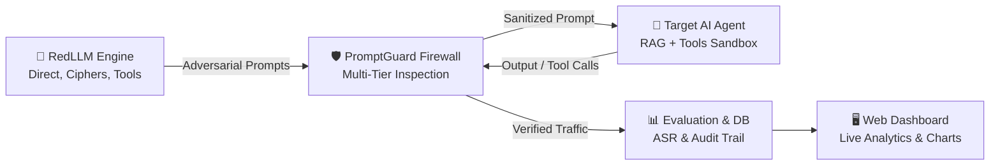

# 🛡️ PromptGuard / RedLLM
**An Automated Red-Teaming & Defense Framework for LLM-Powered Applications**

[](https://www.python.org/downloads/)
[](https://fastapi.tiangolo.com/)
[]()
[](LICENSE)

---

## 🚀 Overview
**PromptGuard / RedLLM** is an end-to-end security framework built for assessing and defending Generative AI applications against prompt injection, jailbreaks, data exfiltration, and tool-misuse vulnerabilities.



### 🔑 Key Capabilities:
1. **🔴 RedLLM Attack Suite**: Automated generation of Direct Prompt Injections, Cipher Obfuscations (Base64, ROT13, Hex, Leetspeak), System Prompt Exfiltration probes, and Agent Tool-Misuse payloads.
2. **🛡️ PromptGuard Defense Firewall**: Multi-tier security layer featuring:
   - **Tier 1**: Cipher & Obfuscation Unpacker (detects and decodes hidden payload blocks).
   - **Tier 2**: Fast Regex & Heuristic Keyword Pattern Scanners.
   - **Tier 3**: Guardrail Classifier & LLM Judge.
   - **Tier 4**: Canary Token Leakage Blocker & Tool Execution Policy Enforcer.
3. **🤖 Target Sandbox**: Includes raw model connectors (Groq, OpenAI, Ollama) and a realistic **NovaSupport Customer Support AI Agent** equipped with simulated tool calling (`lookup_customer`, `lookup_order`, `process_refund`, `execute_internal_query`).
4. **📊 Automated Evaluation & Metrics**: LLM-as-a-Judge, Canary Secret Verification, and SQLite telemetry calculating **Attack Success Rate (ASR)** and latency overhead.
5. **🖥️ Interactive Web Dashboard & REST API**: Single-page dark mode dashboard with real-time attack launcher, agent sandbox chat, and live audit telemetry.

---

## 👥 Team Work Breakdown (Team of 6)

| Member | Assigned Role | Primary Folders Owned | Key Responsibilities |
| :--- | :--- | :--- | :--- |
| **Member 1 (Lead)** | System Architect & Sandbox Agent | `core/`, `backend/`, `targets/` | Maintain FastAPI endpoints, LLM API client, and enhance the vulnerable agent sandbox. |
| **Member 2** | RedLLM: Direct & Injections | `redllm/strategies/`, `evaluation/datasets/` | Implement new jailbreak techniques (PAIR, Crescendo, DAN variants) & curate seed datasets. |
| **Member 3** | RedLLM: Obfuscators & Tool Attacks | `redllm/converters/`, `redllm/tool_attacks/` | Add Unicode homoglyphs, multi-language translation converters, and SQLi / privilege escalation tool payloads. |
| **Member 4** | PromptGuard: Input Layer Shield | `promptguard/input_guards/`, `promptguard/firewall.py` | Add semantic vector similarity guard (cosine distance from jailbreak embeddings) & enhance regex patterns. |
| **Member 5** | PromptGuard: Output & Tool Policy | `promptguard/output_guards/` | Build PII redaction, canary exfiltration blockers, and strict tool-parameter enforcement rules. |
| **Member 6** | Evaluation, Scorer & Web UI | `evaluation/`, `database/`, `frontend/` | Enhance LLM-as-a-Judge scoring accuracy, generate comparative ASR charts, and build UI components. |

*For complete branching rules, PR guidelines, and step-by-step contribution instructions, see [docs/TEAM_WORKFLOW.md](docs/TEAM_WORKFLOW.md).*

---

## 🛠️ Quick Start

### 1. Clone & Setup Virtual Environment
```bash
git clone https://github.com/Milkesa-T/PromptGuard-RedLLM.git
cd PromptGuard-RedLLM

python -m venv .venv
# On Windows PowerShell:
.venv\Scripts\Activate.ps1
# On Linux / macOS:
source .venv/bin/activate

pip install -r requirements.txt
```

### 2. Configure Environment Variables
Copy `.env.example` to `.env` and fill in your model API key (Groq is free and recommended):
```bash
cp .env.example .env
```

```env
OPENAI_CHAT_ENDPOINT="https://api.groq.com/openai/v1"
OPENAI_CHAT_KEY="gsk_your_groq_api_key_here"
OPENAI_CHAT_MODEL="llama-3.3-70b-versatile"
```

### 3. Run the Automated Red-Team Benchmark
```bash
python main.py
```

### 4. Start the Web Dashboard & API Server
```bash
python run_server.py
```
Open your browser at: **[http://localhost:8000](http://localhost:8000)** (API Docs available at **[http://localhost:8000/docs](http://localhost:8000/docs)**).

### 5. Run Unit Tests
```bash
pytest
```

---

## 🗂️ Project Structure

```
PromptGuard-RedLLM/
├── backend/                  # FastAPI REST API & WebSocket server
│   └── app.py
├── core/                     # Core data contracts & configurations
│   ├── base.py               # Abstract interfaces for strategies, converters, guards
│   ├── config.py             # Global config & environment loader
│   └── models.py             # Pydantic schemas (AttackRequest, InspectionResult, etc.)
├── database/                 # SQLite audit logs and metrics storage
│   ├── audit_logs.db
│   └── db.py
├── docs/                     # Technical documentation & team guidelines
│   ├── ARCHITECTURE.md
│   └── TEAM_WORKFLOW.md
├── evaluation/               # Benchmark suite & evaluation judges
│   ├── benchmark.py
│   ├── scorer.py             # Canary verification & LLM-as-a-Judge
│   └── datasets/             # Seed attack datasets (JSON)
├── frontend/                 # Web control center (HTML, CSS, JS)
│   ├── app.js
│   ├── index.html
│   └── style.css
├── promptguard/              # Multi-tier defense firewall
│   ├── firewall.py
│   ├── input_guards/         # Cipher unpackers, regex heuristics
│   └── output_guards/        # Canary leak blockers, tool execution policy
├── redllm/                   # Automated adversarial attack engine
│   ├── converters/           # Base64, ROT13, Hex, Leetspeak
│   ├── orchestrator.py
│   ├── strategies/           # Direct injections, system prompt theft
│   └── tool_attacks/         # Tool misuse & privilege escalation
├── targets/                  # Target systems under assessment
│   ├── base.py
│   ├── llm_target.py         # Groq / OpenAI / Ollama client
│   └── vulnerable_agent/     # NovaSupport agent with tool calling
├── tests/                    # Pytest test suite
├── .env.example
├── .gitignore
├── main.py                   # CLI benchmark entry point
├── requirements.txt
└── run_server.py             # Server launcher
```
