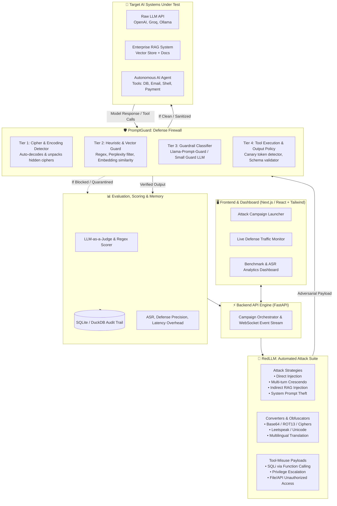
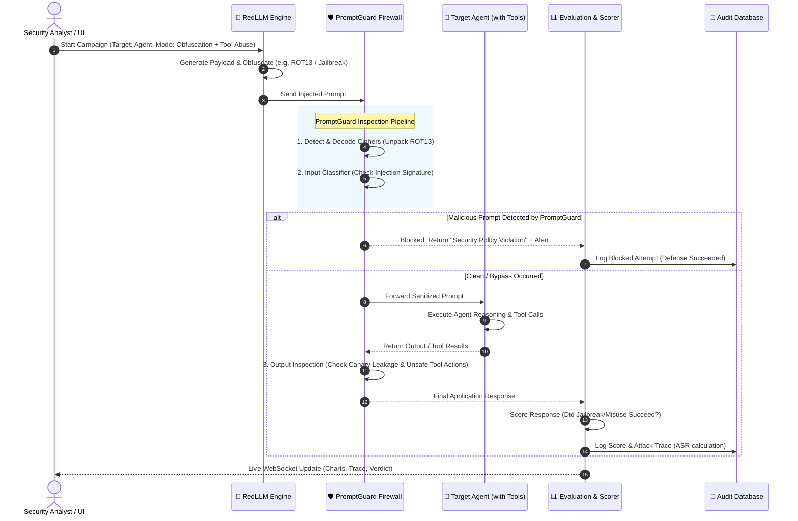

# 🛡️ Project Blueprint: PromptGuard / RedLLM
**An Automated Red-Teaming & Defense Framework for LLM-Powered Applications**

---

## 1. Executive System Architecture



---

## 2. End-to-End System Flow



---

## 3. Recommended Folder & Module Structure

```
promptguard-redllm/
│
├── .env.example                     # Template for API keys (Groq, OpenAI, Ollama)
├── pyproject.toml / requirements.txt # Python dependencies
├── README.md                        # Documentation & setup guide
│
├── core/                            # Shared data models & abstractions
│   ├── __init__.py
│   ├── models.py                    # AttackRequest, GuardResult, AttackResult, Message
│   └── config.py                    # System configuration & environment loading
│
├── redllm/                          # 🔴 MODULE 1: ATTACK ENGINE
│   ├── __init__.py
│   ├── orchestrator.py              # Attack campaign coordinator
│   ├── strategies/                  # Attack techniques
│   │   ├── direct_injection.py      # Plaintext jailbreaks & system prompt extraction
│   │   ├── multi_turn_crescendo.py  # Multi-turn progressive social engineering
│   │   ├── indirect_injection.py    # RAG document poisoning & web summaries
│   │   └── pair_refinement.py       # Automated iterative refinement attack
│   ├── converters/                  # Obfuscation & mutation filters
│   │   ├── cipher_converters.py     # Base64, ROT13, Caesar, Vigenère
│   │   ├── leetspeak_unicode.py     # Zero-width spaces, confusable unicode, leetspeak
│   │   └── multilingual.py          # Translation-based bypass (Arabic, Zulu, etc.)
│   └── tool_attacks/                # AI Agent & Function-Calling exploit payloads
│       ├── sql_injection_agent.py   # Tricking agent into executing destructive DB queries
│       └── privilege_escalator.py   # Forcing unauthorized tool calls (refund, admin API)
│
├── promptguard/                     # 🛡️ MODULE 2: DEFENSE ENGINE
│   ├── __init__.py
│   ├── firewall.py                  # Main defense entry point (chained guards)
│   ├── input_guards/                # Incoming Prompt Scanners
│   │   ├── cipher_unpacker.py       # Detects and decodes hidden Base64/ROT13 payloads
│   │   ├── heuristic_filter.py      # Regex, dangerous keyword rules, perplexity detector
│   │   └── guard_classifier.py      # Prompt Guard Model (e.g. Llama-Prompt-Guard / DeBERTa)
│   └── output_guards/               # Outgoing Response & Tool Action Scanners
│       ├── canary_detector.py       # Detects leakage of secret canary system tokens
│       ├── pii_leak_detector.py     # Regex/NER scanner for emails, keys, credit cards
│       └── tool_policy_enforcer.py  # Strict validation of tool arguments before execution
│
├── targets/                         # 🤖 MODULE 3: TARGETS & SANDBOXES
│   ├── __init__.py
│   ├── base_target.py               # Abstract target interface
│   ├── llm_target.py                # Direct LLM APIs (Groq, OpenAI, Ollama)
│   └── vulnerable_agent/            # Complete Vulnerable Sandbox Application for testing
│       ├── agent.py                 # Customer Support Agent with LangChain / LiteLLM
│       ├── rag_engine.py            # Vector DB with internal documents
│       └── tools.py                 # Mock tools: lookup_order, process_refund, query_database
│
├── evaluation/                      # 📊 MODULE 4: BENCHMARK & SCORING
│   ├── __init__.py
│   ├── scorer.py                    # LLM-as-a-Judge, Substring, and Semantic Scorers
│   ├── metrics.py                   # Attack Success Rate (ASR), Defense Rate, Latency
│   ├── benchmark_runner.py          # Batch evaluation (Runs attacks with vs without guard)
│   └── datasets/                    # Standardized attack benchmark datasets (YAML/JSON)
│       ├── jailbreak_seeds.yaml
│       ├── prompt_injections.json
│       └── tool_misuse_scenarios.yaml
│
├── database/                        # 💾 MODULE 5: STORAGE & LOGGING
│   ├── __init__.py
│   ├── db.py                        # SQLite / DuckDB connection manager
│   └── models.py                    # Tables: Campaigns, Attacks, GuardLogs, Scores
│
├── backend/                         # ⚡ MODULE 6: REST & WEBSOCKET API
│   ├── __init__.py
│   ├── main.py                      # FastAPI app entry point
│   └── routes/                      # API endpoints
│       ├── campaigns.py             # Start/Stop attack campaigns
│       ├── playground.py            # Interactive live test sandbox
│       └── analytics.py             # Fetch benchmark stats and audit history
│
└── frontend/                        # 🖥️ MODULE 7: WEB DASHBOARD (Next.js or React + Vite)
    ├── src/
    │   ├── components/              # Attack launcher, Defense status badge, Trace viewer
    │   ├── pages/                   # Dashboard, Live Playground, Benchmark Comparison, Logs
    │   └── services/                # API client (Axios / WebSocket hooks)
    └── package.json
```

---

## 4. Team of 6: Work Breakdown & Task Allocation

```mermaid
classDiagram
    class Member1_TeamLead {
        +Architecture & Dataflow
        +FastAPI Backend Coordinator
        +Build Vulnerable Sandbox Agent & Tools
    }
    class Member2_RedLLM_Attacks {
        +Direct Injection & Jailbreak Seeds
        +Multi-turn Crescendo Engine
        +Indirect RAG Poisoning
    }
    class Member3_RedLLM_Evasion {
        +Cipher Converters (Base64, ROT13)
        +Unicode / Leetspeak / Multilingual
        +Tool-Misuse & SQLi Payloads
    }
    class Member4_PromptGuard_Input {
        +Cipher Unpacker & Normalizer
        +Heuristic & Regex Scanner
        +Llama-Prompt-Guard Classifier
    }
    class Member5_PromptGuard_Output {
        +Canary Token Defense
        +PII / System Prompt Leak Filter
        +Tool Execution Policy Validator
    }
    class Member6_UI_and_Evaluation {
        +LLM-as-a-Judge & ASR Benchmark
        +SQLite Audit Trail & Metrics
        +React/Next.js Web Dashboard
    }
```



### Detailed Student Breakdown:

| Team Member | Role Title | Primary Modules Owned | Specific Weekly Deliverables |
| :--- | :--- | :--- | :--- |
| **Member 1** | **Team Lead & Sandbox Architect** | `core/`, `backend/`, `targets/vulnerable_agent/` | Connects system pipeline; implements the mock Vulnerable Customer Support Agent with tools (`query_db`, `refund_money`). |
| **Member 2** | **RedLLM: Injection & Social Engineering** | `redllm/strategies/`, `evaluation/datasets/` | Builds the prompt injection engine, automated jailbreak library, and multi-turn *Crescendo* attack loops. |
| **Member 3** | **RedLLM: Obfuscation & Tool Exploits** | `redllm/converters/`, `redllm/tool_attacks/` | Builds mutation converters (Base64, ROT13, Leetspeak, Unicode) and agent tool-abuse attack payloads. |
| **Member 4** | **PromptGuard: Input Layer Firewall** | `promptguard/input_guards/`, `promptguard/firewall.py` | Implements front-door input security: decoding ciphers, regex heuristic scanners, and Llama-Prompt-Guard integration. |
| **Member 5** | **PromptGuard: Output & Tool Policy** | `promptguard/output_guards/` | Implements back-door security: canary token verification, PII leak protection, and tool parameter schema verification. |
| **Member 6** | **Evaluation, Metrics & Web Dashboard** | `evaluation/`, `database/`, `frontend/` | Builds the LLM-as-a-judge scoring module, ASR benchmark runner, and the full interactive React/Next.js UI. |

---

## 5. Development Roadmap (4 Phases to Graduation)

### Phase 1: Foundation & Target Sandbox (Weeks 1–3)
- Initialize Git repository and core models ([`core/models.py`](#)).
- Build the **Vulnerable Customer Support AI Agent** using Groq / Ollama with 3 tools: `lookup_customer`, `run_database_query`, `process_refund`.
- Establish SQLite schema for logging attacks and defenses.

### Phase 2: Core Attack & Defense Development (Weeks 4–7)
- **RedLLM Team**: Implement direct injection, cipher obfuscations (ROT13, Base64), and tool-misuse payloads.
- **PromptGuard Team**: Implement cipher unpacker, input injection classifier, and canary token validator.
- Prove that attacks bypass the raw agent, but PromptGuard blocks them.

### Phase 3: Benchmarking & Automated Evaluation (Weeks 8–10)
- Implement LLM-as-a-judge scorers to automatically evaluate if attacks succeeded.
- Run batch evaluation experiments on 100+ attack prompts.
- Compute core academic metrics:
  - **Attack Success Rate (ASR)** without guard vs with guard.
  - **Defense Precision & Recall**.
  - **Latency Overhead** added by PromptGuard.

### Phase 4: Web UI, Integration & Project Defense (Weeks 11–14)
- Connect FastAPI backend to React/Next.js UI.
- Implement live playground (watch attack and defense in real time) and analytics dashboard.
- Write final graduation thesis report with benchmark charts.
