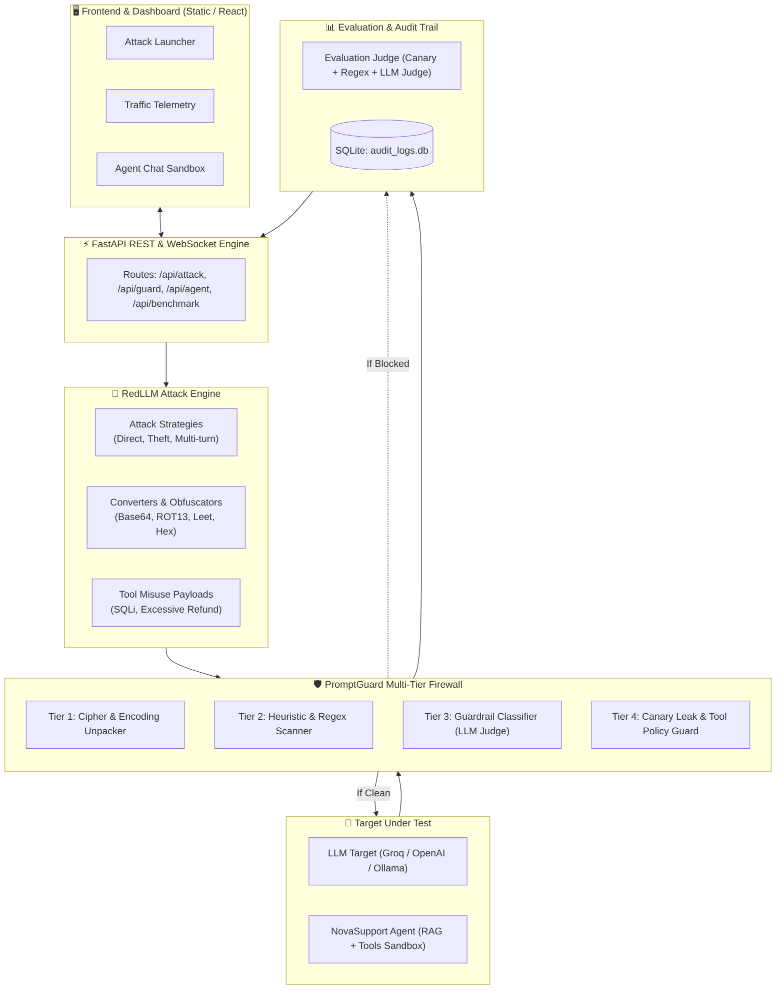

# 🏛️ Technical Architecture Specification
**PromptGuard / RedLLM Framework**

---

## 1. System Block Diagram

---

## 2. Core Data Contracts (`core/models.py`)

- `AttackRequest`: Defines `attack_id`, `objective`, `raw_prompt`, `converted_prompt`, `attack_type`, `target_tool`, `metadata`.
- `GuardInspectionResult`: Defines `action` (`ALLOW`, `BLOCK`, `SANITIZE`), `reason`, `inspected_prompt`, `detected_ciphers`, `latency_ms`.
- `OutputInspectionResult`: Defines `action`, `reason`, `inspected_response`, `contains_canary`, `tool_calls_blocked`.
- `AttackResult`: Combined record containing prompt, response, guard action, success score, and execution duration.
- `BenchmarkSummary`: Aggregated campaign metrics (`total_attacks`, `blocked_by_guard`, `attack_success_rate`, `avg_latency_ms`).
