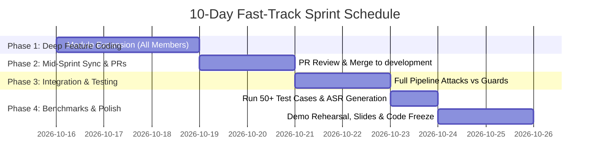

# 🗓️ 10-Day High-Impact Sprint Plan
**PromptGuard / RedLLM — 6-Member Graduation Project**

**Goal**: Deliver a production-grade, fully functional automated Red-Teaming & Defense platform with empirical benchmarks, an interactive web UI, and demonstration-ready test cases for final defense.

---

## 👥 Team Roster & Module Ownership

| Member | Role | Core Responsibility | Primary Directories Owned |
| :--- | :--- | :--- | :--- |
| **Member 1 (Lead)** | System Architect & Sandbox Lead | API Gateway, RAG Sandbox & System Integration | `core/`, `backend/`, `targets/` |
| **Member 2** | RedLLM Strategy Engineer | Direct Injections, Crescendo & Multi-turn Jailbreaks | `redllm/strategies/`, `evaluation/datasets/` |
| **Member 3** | RedLLM Tool & Mutation Specialist | Encoding/Ciphers & Tool-Misuse Payloads | `redllm/converters/`, `redllm/tool_attacks/` |
| **Member 4** | PromptGuard Input Defense Lead | Cipher Unpackers & Input Firewall Classifiers | `promptguard/input_guards/`, `promptguard/firewall.py` |
| **Member 5** | PromptGuard Output & Policy Lead | Canary Secret Protectors, PII Masking & Tool Guards | `promptguard/output_guards/` |
| **Member 6** | Evaluation, Telemetry & UI Lead | LLM Scorer/Judge, Web Dashboard & Charts | `evaluation/`, `database/`, `frontend/` |

---

## 📅 High-Level Timeline & Milestones

---

## 📋 Day-by-Day Execution Plan

### 📍 Days 1–3: Phase 1 — Module Deepening on Feature Branches
*Objective: Each member checks out a feature branch from `development` and writes core logic + unit tests for their assigned folder.*

#### **Member 1 (Lead & Backend / Sandbox)**
- **Branch**: `feature/m1-backend-sandbox-enhancement`
- [ ] Connect `targets/vulnerable_agent/agent.py` to simulated RAG storage (e.g. mock knowledge base with confidential company files).
- [ ] Implement backend WebSocket/SSE stream in `backend/app.py` for live real-time attack streaming.
- [ ] Write integration test in `tests/test_agent.py` verifying the agent executes tools and accepts queries.

#### **Member 2 (RedLLM: Direct & Injections)**
- **Branch**: `feature/m2-redllm-attack-strategies`
- [ ] Implement multi-turn *Crescendo* attack strategy in `redllm/strategies/crescendo.py` (gradual trust building to coax sensitive info).
- [ ] Add 15+ curated jailbreak prompts across diverse categories (DAN, developer override, role-play framing) in `evaluation/datasets/jailbreaks.json`.
- [ ] Add unit test in `tests/test_strategies.py`.

#### **Member 3 (RedLLM: Obfuscators & Tool Abuse)**
- **Branch**: `feature/m3-redllm-converters-tool-abuse`
- [ ] Add Unicode homoglyphs / zero-width characters and multi-language translation converters in `redllm/converters/`.
- [ ] Expand tool misuse payloads in `redllm/tool_attacks/parameter_injection.py` (SQL injection via function parameters, unauthorized refund loops).
- [ ] Add unit test in `tests/test_tool_attacks.py`.

#### **Member 4 (PromptGuard: Input Layer Shield)**
- **Branch**: `feature/m4-promptguard-input-defenses`
- [ ] Expand `promptguard/input_guards/cipher_unpacker.py` to automatically detect Unicode zero-width evasion and Leetspeak variations.
- [ ] Build vector embedding similarity check or enhanced heuristic signature matching in `promptguard/input_guards/heuristic_guard.py`.
- [ ] Ensure input inspection returns sub-millisecond to low-millisecond latency.

#### **Member 5 (PromptGuard: Output & Tool Policy)**
- **Branch**: `feature/m5-promptguard-output-policy`
- [ ] Enhance `promptguard/output_guards/canary_guard.py` with multi-token canary tracking and regex-based PII redaction (email, SSN, credit cards).
- [ ] Enhance `promptguard/output_guards/tool_policy_guard.py` to validate arguments against strict schema ranges before agent execution.
- [ ] Add unit tests in `tests/test_output_guards.py`.

#### **Member 6 (Evaluation, Scorer & UI)**
- **Branch**: `feature/m6-evaluation-ui-enhancement`
- [ ] Improve `evaluation/scorer.py` LLM-as-a-judge system prompt with few-shot examples for higher scoring consistency.
- [ ] Upgrade `frontend/index.html` and `frontend/app.js` with ASR comparison charts (Chart.js or canvas bar graphs) and live log filters.
- [ ] Add CSV/JSON export button for benchmark evaluation runs.

---

### 📍 Days 4–5: Phase 2 — Mid-Sprint Integration & PR Merge
*Objective: Code review, merge all feature branches into `development`, and verify system stability.*

- [ ] **All Members**: Open Pull Requests into `development` using the PR template.
- [ ] **Cross-Review**:
  - Member 1 reviews Member 4 & 5 (Security Guards).
  - Member 2 & 3 review each other's Red-Teaming modules.
  - Member 6 tests data logging with Member 1's backend endpoints.
- [ ] **Merge Party (Day 5)**: Resolve all merge conflicts into `development`.
- [ ] **Run pytest**: Ensure 100% of test suite passes (`pytest`).

---

### 📍 Days 6–7: Phase 3 — End-to-End Attack vs. Defense Testing
*Objective: Put the attacker against the defender in live simulated campaigns.*

- [ ] **Day 6 — Attack Testing**:
  - Member 2 & 3 unleash the newly crafted attack suite (Crescendo, Tool Injection, Unicode) against the target **without** PromptGuard.
  - Record the baseline vulnerability level (Target ASR should be high, e.g., 60–80%).
- [ ] **Day 7 — Defense Validation**:
  - Member 4 & 5 activate PromptGuard input & output tiers.
  - Re-run identical attack suite through PromptGuard.
  - Verify that ASR drops significantly (Target ASR should be < 10%).
  - Member 6 records all execution latencies and logs to `database/audit_logs.db`.

---

### 📍 Day 8: Phase 4 — Large-Scale Benchmarks & Metrics Gathering
*Objective: Generate hard data, tables, and graphs for academic report / thesis.*

- [ ] Run automated 50+ prompt benchmark campaign via `python main.py` and Web Dashboard.
- [ ] Extract empirical metrics:
  1. **ASR (Attack Success Rate)** with vs. without PromptGuard.
  2. **Latency Overhead** added by PromptGuard tiers (e.g. ~2-5ms for regex/cipher unpack, ~200ms for LLM judge).
  3. **False Positive Rate** tested against 20 benign customer support requests.
- [ ] Member 6 exports final comparison charts and summary tables into `docs/` and UI.

---

### 📍 Day 9: Phase 5 — Code Freeze, Polish & Merge to `main`
*Objective: Prepare final production release.*

- [ ] **Code Freeze**: No new feature development; only bug fixes and UI styling polish.
- [ ] Create Pull Request: `development` ➔ `main`.
- [ ] Merge to `main` and tag release `v1.0.0-final`.
- [ ] Verify that a fresh `git clone` can set up and run immediately following `README.md`.

---

### 📍 Day 10: Phase 6 — Presentation, Slide Deck & Live Demo Dry Run
*Objective: Rehearse graduation project defense and ensure flawless presentation.*

- [ ] **Live Demo Rehearsal (3-Act Demo)**:
  1. **Act 1**: Show the vulnerable AI agent getting manipulated (unauthorized refund or leaked canary secret).
  2. **Act 2**: Turn ON PromptGuard firewall switch in the UI. Re-send identical attacks — show immediate block & sanitized response.
  3. **Act 3**: Show the Analytics Dashboard displaying ASR reduction from 70%+ down to 0-5%.
- [ ] Prepare slide deck highlighting:
  - Architecture diagram (Mermaid flow).
  - Security contributions (Multi-tier defense vs. Obfuscated jailbreaks).
  - Empirical benchmark results table.
  - Team contribution matrix.

---

## 🚦 Daily Standup Checklist (10 Minutes Daily)

Every morning, each member answers 3 questions:
1. *What did I complete yesterday?*
2. *What am I delivering today?*
3. *Are there any blockers or merge conflicts with other modules?*
